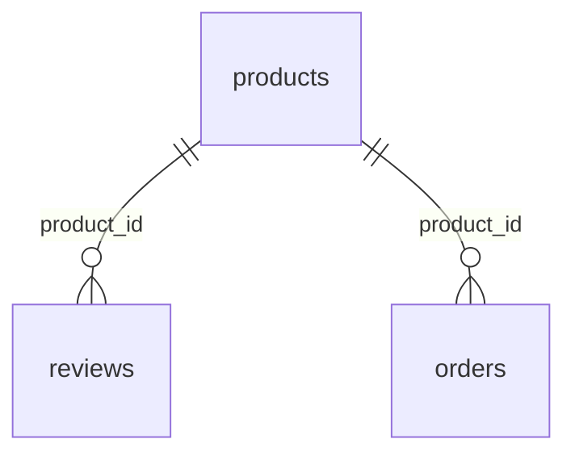

# Multi-Format Data Warehouse (CSV + JSON → PostgreSQL)

A small ETL pipeline that combines an orders CSV and a nested product-reviews JSON file into one PostgreSQL database. It cleans the data, sends every rejected row to an errors file with a reason, and loads the rest in a single transaction.

## Project structure

```
.
├── data/
│   ├── product_reviews.json   # nested reviews by product
│   └── orders__1_.csv         # orders (one row per order)
├── extract.py        # read the raw files into DataFrames (no cleaning)
├── clean.py          # clean each table; return valid rows, rejected rows, duplicate count
├── load.py           # connect to Postgres and upsert (parents before children)
├── main.py           # run extract → clean → errors file → count check → load
├── schema.sql        # CREATE TABLE statements
├── requirements.txt  # Python dependencies
├── .env.example      # template for your .env (the real .env is not committed)
└── errors.csv        # created on each run: every rejected row and why
```

## Setup

1. Clone the repo and install dependencies:
   ```
   git clone https://github.com/Robiah-9/Multi-Format-Warehouse.git
   cd Multi-Format-Warehouse
   pip install -r requirements.txt
   ```
2. Create a PostgreSQL database (e.g. `warehouse`) and run `schema.sql` in pgAdmin's Query Tool or with `psql`.
3. Copy `.env.example` to `.env` and fill in your credentials (no quotes, no spaces around `=`):
   ```
   DB_HOST=localhost
   DB_PORT=5432
   DB_NAME=warehouse
   DB_USER=postgres
   DB_PASSWORD=your_password
   ```
4. Run from the project folder (the sample data in `data/` is already wired up):
   ```
   python main.py
   ```
   To use your own files, change `PRODUCTS_JSON` and `ORDERS_CSV` at the top of `main.py`.

## Database schema

```sql
CREATE TABLE products (
    product_id   VARCHAR(10)  PRIMARY KEY,
    product_name VARCHAR(100) NOT NULL,
    category     VARCHAR(50)  NOT NULL
);

CREATE TABLE reviews (
    review_id   VARCHAR(10) PRIMARY KEY,
    customer_id VARCHAR(10) NOT NULL,
    product_id  VARCHAR(10) NOT NULL REFERENCES products(product_id),
    rating      INTEGER     NOT NULL CHECK (rating BETWEEN 1 AND 5),
    comment     TEXT,
    review_date DATE        NOT NULL
);

CREATE TABLE orders (
    order_id      VARCHAR(10)   PRIMARY KEY,
    customer_id   VARCHAR(10)   NOT NULL,
    product_id    VARCHAR(10)   NOT NULL REFERENCES products(product_id),
    quantity      INTEGER       NOT NULL CHECK (quantity >= 1),
    unit_price    DECIMAL(10,2) NOT NULL,
    order_date    DATE          NOT NULL,
    price_imputed BOOLEAN       NOT NULL DEFAULT FALSE
);
```



`customer_id` has no foreign key because there is no customers table.

## Cleaning rules

Rules are applied in this order, so each row ends up in exactly one bucket.

| Table | Step | Rule | Outcome |
|---|---|---|---|
| Products | 1 | Strip spaces, lowercase category | Merges `Accessories` / `accessories` / `ELECTRONICS` variants |
| Reviews | 1 | Duplicate `review_id` | Later copies removed and counted |
| Reviews | 2 | `product_id` not in products | Rejected |
| Reviews | 3 | Rating outside 1–5 | Rejected |
| Reviews | 4 | Parse 3 date formats (`2025-12-17`, `January 15, 2026`, `19/01/2026`) | Unparseable dates rejected |
| Orders | 1 | Exact duplicate rows | Removed and counted |
| Orders | 2 | `product_id` not in products | Rejected |
| Orders | 3 | Quantity below 1 | Rejected |
| Orders | 4 | Missing price | Filled with that product's mean, rounded to 2 decimals, `price_imputed = TRUE` |
| Orders | 5 | Parse `month/day/year` dates | Unparseable dates rejected |

Note that the two files use opposite date orders: reviews are day/month/year and orders are month/day/year.

## How the load works

- **Upsert:** `INSERT ... ON CONFLICT (key) DO UPDATE`, so running the pipeline again updates rows instead of failing or duplicating them.
- **One transaction:** if any insert fails, everything is rolled back and nothing is half-loaded.
- **Order:** `products` first, then `reviews` and `orders`, because of the foreign keys.
- **Credentials:** read from `.env`; missing values raise a clear error before connecting.

## Row accounting

`main.py` checks this before touching the database and stops if it doesn't hold:

```
rows in = loaded + rejected + duplicates removed
```

For the included data:

| | Rows |
|---|---|
| In (31 reviews + 310 orders) | 341 |
| Duplicates removed | 13 |
| Rejected (see `errors.csv`) | 11 |
| Loaded (26 reviews + 291 orders) | 317 |

Products (10 rows) are loaded separately and none are rejected.

## Verifying in the database

```sql
SELECT 'products' AS tbl, COUNT(*) FROM products
UNION ALL SELECT 'reviews', COUNT(*) FROM reviews
UNION ALL SELECT 'orders',  COUNT(*) FROM orders;
-- expected: 10, 26, 291
```

Running `python main.py` a second time should leave these counts unchanged.

## Example queries

```sql
-- Average rating and review count by category
SELECT p.category, ROUND(AVG(r.rating), 2) AS avg_rating, COUNT(r.review_id) AS reviews
FROM products p
LEFT JOIN reviews r ON r.product_id = p.product_id
GROUP BY p.category
ORDER BY reviews DESC;

-- Monthly revenue
SELECT DATE_TRUNC('month', order_date) AS month, SUM(quantity * unit_price) AS revenue
FROM orders
GROUP BY 1
ORDER BY 1;

-- Revenue that rests on estimated prices
SELECT SUM(quantity * unit_price) AS estimated_revenue
FROM orders
WHERE price_imputed;
```

## Known limitations

- Missing prices are filled with the product mean, which is an estimate. Filter on `price_imputed` when exact figures matter.
- Rejected rows are not reloaded automatically; fix the source data and run again.
- Customers are plain IDs with no dimension table.

**Author:** Robiat